# WannaCry 

 

 El día 12 de mayo se produjo una campaña de ransomware a nivel mundial conocida como WannaCry, que se aprovechaba de una vulnerabilidad en el protocolo SMB v1, que fue corregida por Microsoft el 14 de marzo, pero solo en los equipos que instalaran la actualización. 

 

 WannaCry atacó a todos los equipos que seguían sin parchear, dos meses después, se propagaba solo de un equipo a otro por el puerto 445 (SMB), sin que nadie tuviera que abrir un archivo ni hacer clic en nada.  

 

 El ransomware solicitó el pago de 300$ para recuperar la información cifrada, aunque nadie recuperó sus archivos pagando.  

 

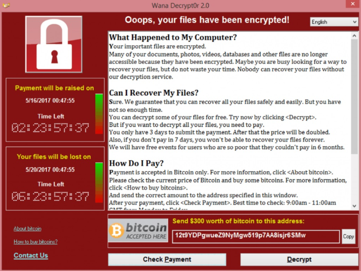
 

 
 

# Mittre attack 

 

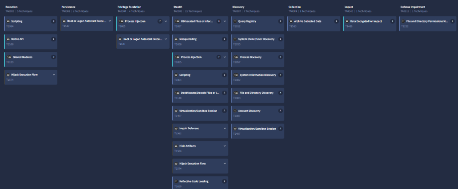

 

Podemos observar en esta tabla del Mittre Attack todas las tácticas y técnicas que realiza el WannaCry. 

 
 
### Scripting  

 
 

Usa la táctica de scripting porque suelta archivos de Visual Basic, ejecuta archivos (.bat) y ejecuta scripts de Visual Basic. 

### Persistencia 

 

Usa la táctica de persistencia por que modifica reglas de registro para guardar archivos en el directorio de inicio de Windows. 

### Escalada de privilegios 

 

Usa la táctica de Escalada de privilegios por q consigue hacer un Process Howling en donde inyecta código malicioso en procesos suspendidos. 

 

# Análisis de malware en vivo 

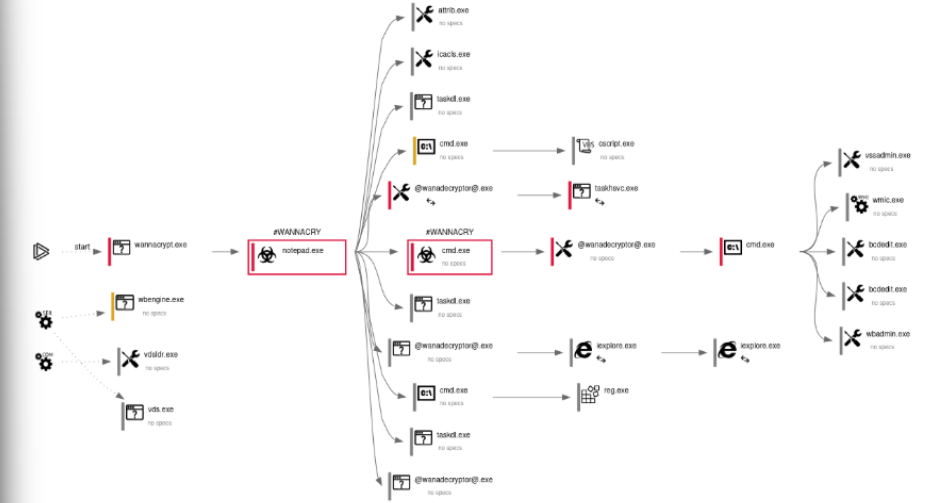
 
 

Al ejecutarse wannacrypt.exe en el ordenador infectado, se crean una gran cantidad de archivos .exe que contienen código arbitrario, que se ejecuta en el momento que se terminen de crear. 

 

En la tercera columna de la imagen se pueden observar los archivos que crea y lo que hace cada uno. 
 

 

Aparte de ser persistentes, se ejecutan de nuevo cada vez que se inicie Windows, para evitar el borrado (se puede saber que se están creando porque saturan la CPU del ordenador y posteriormente el disco porque está escribiendo).  

 

Se puede ver en la imagen por ejemplo el taskmgr.exe que es un proceso legítimo de Windows, pero este lo enmascara y se hace pasar por el proceso para que se ejecute a la hora de lanzar el SO.  

 

Después una vez creados los ejecuta automáticamente dando lugar una encriptación completa de todos nuestros archivos originales que ya teníamos. 

 
Podemos observar cómo al ejecutarse, la CPU sube a niveles altísimos, esto es dado por el hecho de que se están creando los archivos. 

 

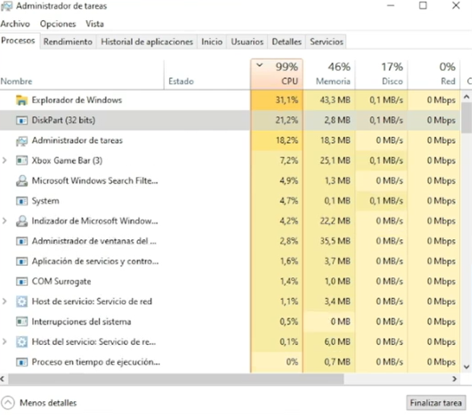

 

 

Cuando el fondo de pantalla es alterado, se confirma la encriptación completa de todos los archivos del disco. 

 
 
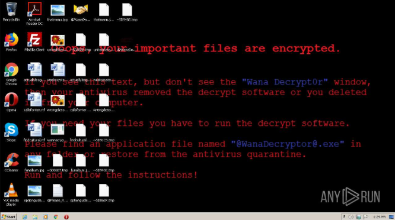

 

Uno de los últimos “.exe”, nos muestra como “recuperar” el acceso a nuestros archivos encriptados, pagando a una cartera de bitcoin. 

 
 
 
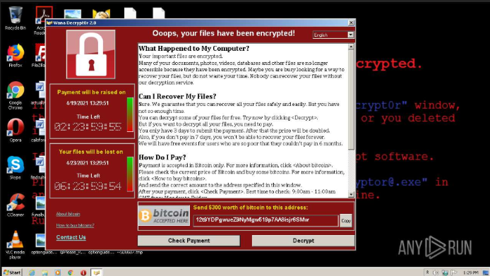

 
 

Nos otorga 10 archivos desencriptados gratuitamente como demostración.  

 
 
 
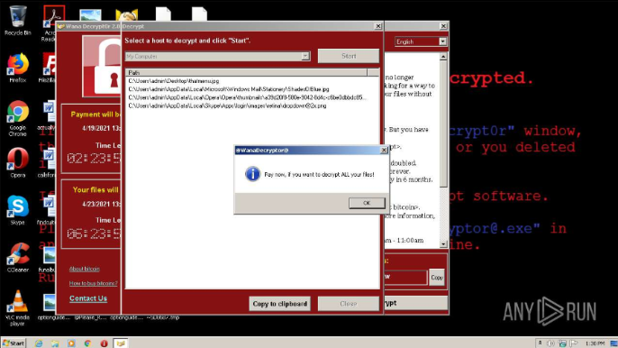

 
 

 

 

# Indicadores de Compromiso (IOCs) 

 

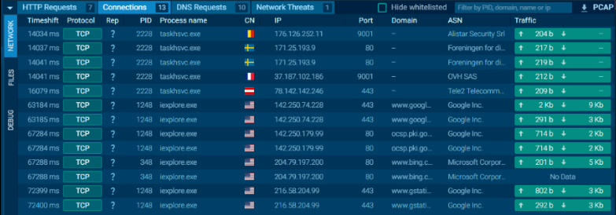

 

Las direcciones ip que se observan en la imagen, son las que el malware realizaba peticiones, en la versión original del ataque de “WannaCry” este consultaba el dominio:  

iuqerfsodp9ifjaposdfjhgosurijfaewrwergwea.com 

Si no estaba activo(registrado) el dominio se ejecutaba el malware, se paró el ataque gracias a que una persona registró el dominio. 

Hashes de WannaCry extraídos de VirusTotal: 

 

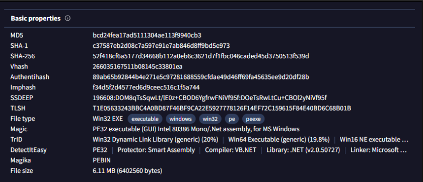
 
 
 

# VirusTotal para mirar telemetría y detección (subir el hash) 

 
 

En esta imagen podemos observar todos los procesos creados por el WannaCry. 

 
 
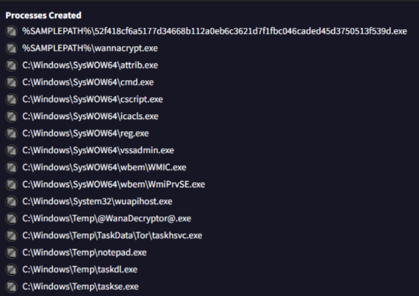
 
 

 

Estos son todos los comandos que ha realizado el WannaCry por detrás, unos de los comandos más críticos que realiza es la eliminación de una “shadowcopy” de Windows, que establece por predeterminado una política que ignora todos los errores al iniciar el sistema operativo de Windows y también podemos ver que desactiva toda opción de intentar la recuperación de esos archivos mediante copias de seguridad. 

 
 
 
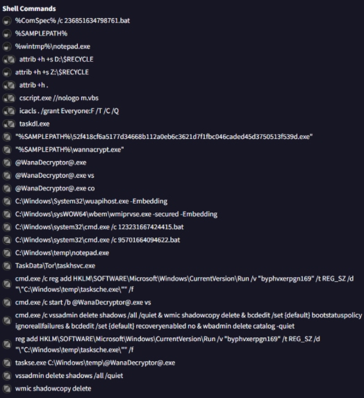
 
 
 

En esta imagen nos muestra todos los procesos en los q ha inyectado código malicioso. 

 
 
 
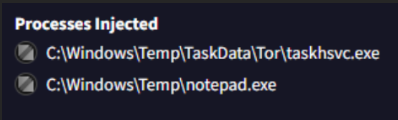
 
 
 
 

En esta imagen podemos observar todos los archivos q ha abierto el WannaCry. 

 
 
 
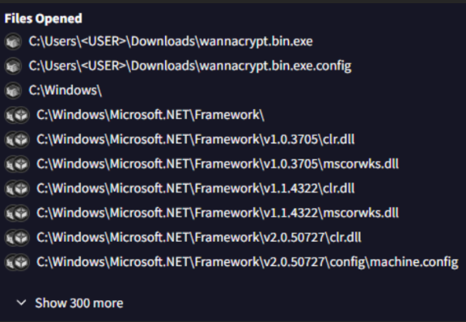
 
 
 

Podemos observar todos los archivos en los que ha escrito WannaCry. 

 
 
 
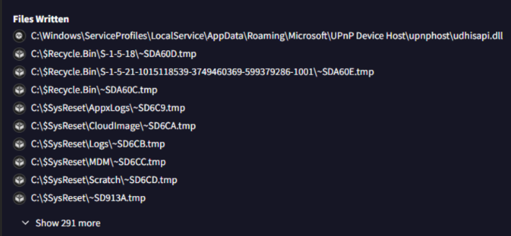
 
 
 

 

Podemos observar todos los archivos en los que WannaCry ha modificado atributos. 

 
 
 
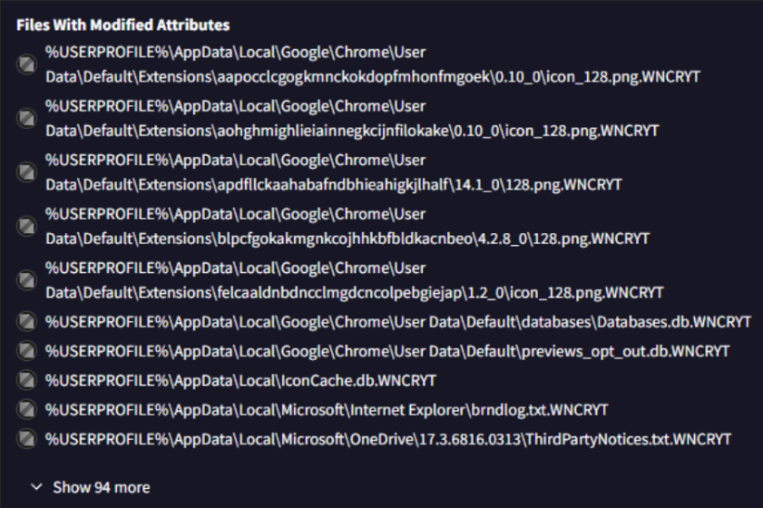
 
 
 

 

Podemos observar a todas las direcciones ip que ha hecho conexión el WannaCry. 

 
 
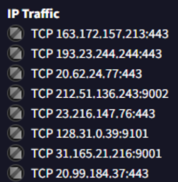
 
 

